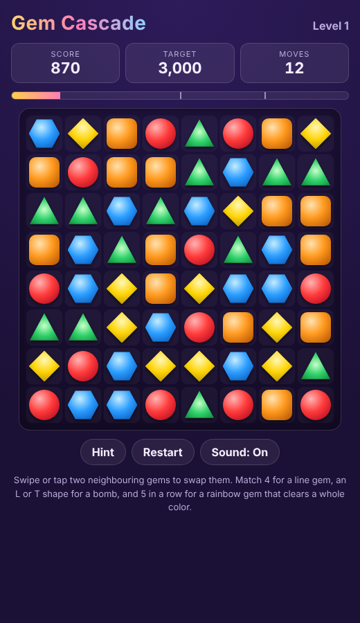

# Gem Cascade

A match-3 puzzle game built from scratch in vanilla JavaScript. Swap gems, set off chain reactions with special gems, and beat three levels whose difficulty was tuned with a headless bot simulator.

**Play it:** `https://maggiee18.github.io/gem-cascade/`



## Features

* **Swipe or tap controls** using Pointer Events, so it works with mouse, touch and pen
* **Cascades and combos.** Each chain reaction multiplies the points for every gem it clears
* **Special gems**
  * Match 4 in a line to make a **line gem** that clears a full row or column
  * Match an L or T shape to make a **bomb** that clears a 3x3 area
  * Match 5 in a line to make a **rainbow gem** that clears every gem of one color
  * Special gems caught in a blast fire too, so they chain into each other
* **Three levels** with move limits, score targets and a 1 to 3 star rating
* **Hints and auto shuffle.** The game suggests a move after 7 seconds of no input and reshuffles when no legal move is left
* **Accessible gem design.** Each color also has its own shape, so the board stays readable for color blind players
* **Sound effects** generated with the Web Audio API, so the game ships no audio files
* **No dependencies.** No frameworks, no bundler and no npm packages

## How it works

The project keeps game logic and rendering fully separate.

```
src/core.js     Pure game engine: board, matching, specials, gravity, scoring, levels
src/ui.js       DOM renderer, animation queue and input handling
src/styles.css  Gem shapes, special gem effects and animations
scripts/        Level balancing simulator and single file build
test/           Unit tests for the engine
```

`core.js` has no DOM access, so the same code runs in the browser, in the unit tests and in the simulator.

### Turn resolution

A swap goes through a loop that repeats until the board is stable:

1. **Validate.** The gems must be neighbours, and the swap must create a match or involve a rainbow gem
2. **Detect matches.** One pass over rows and one over columns finds every run of 3 or more
3. **Group shapes.** Runs that share a cell are merged with **union-find**, which is how L and T shapes are recognised
4. **Decide specials.** Each group's shape picks the special gem it creates and where to place it
5. **Expand blasts.** A **breadth-first search** spreads through special gems caught in the cleared area, so chain reactions resolve in the right order
6. **Apply gravity.** Each column is compacted bottom up in one pass, and new gems spawn from the top
7. **Repeat** for the next cascade with a higher multiplier

The engine returns each cascade as an animation step (cleared tile ids, created specials, spawned tiles and new positions). The UI plays these steps in order with CSS transforms, which keeps rendering smooth without a canvas or game library.

### Fair boards

* Starting boards are generated cell by cell so they never begin with a match
* A board with no legal move is shuffled with Fisher Yates until it is playable again
* A seeded PRNG (mulberry32) makes any game reproducible from its seed, which the tests and simulator rely on

## Level balancing

`scripts/simulate.js` plays hundreds of games per level with two bots:

* **Random** picks any legal move, roughly a new player
* **Greedy** simulates every legal swap on a copy of the board and keeps the highest scoring one, roughly a skilled player

The results were used to set each level's moves and score target so the difficulty rises from level to level:

| Level | Board | Gem types | Moves | Target | Random bot win rate | Greedy bot win rate |
|---|---|---|---|---|---|---|
| 1 | 8 x 8 | 5 | 20 | 3,000 | 39% | 100% |
| 2 | 8 x 8 | 6 | 24 | 3,000 | 9% | 74% |
| 3 | 9 x 9 | 6 | 24 | 4,500 | 1% | 60% |

*200 games per level and bot.*

Run it yourself:

```bash
node scripts/simulate.js 200
```

## Run locally

Requires Node.js 18 or newer for the tests and scripts. The game itself needs only a browser.

```bash
git clone https://github.com/Maggiee18/gem-cascade.git
cd gem-cascade

# Play: open index.html in a browser, or serve the folder
npx serve .

# Run the unit tests (Node's built-in test runner)
npm test

# Run the level balancing simulator
npm run simulate

# Build a single self-contained dist/index.html
npm run build
```

## Tests

The engine tests cover:

* Starting boards with no matches and at least one legal move
* Horizontal, vertical, L and T match detection
* Special gem creation for 4, 5 and L or T matches
* Rejection of illegal swaps
* Gravity, refill and cascade resolution
* Line gem and rainbow gem blasts
* Shuffling into a playable board
* Move and score bookkeeping

GitHub Actions runs the tests, a short simulation and the build on every push.

## Deploying to GitHub Pages

1. Push the repository to GitHub
2. Go to **Settings > Pages**
3. Under **Build and deployment**, choose **Deploy from a branch**, then pick `main` and `/ (root)`
4. The game goes live at `https://<username>.github.io/gem-cascade/`

## Possible next steps

* Obstacle tiles (ice, locked gems) and level goals beyond score
* A level editor that saves layouts as JSON
* Saved progress and best scores
* A canvas renderer for larger boards

## License

MIT
